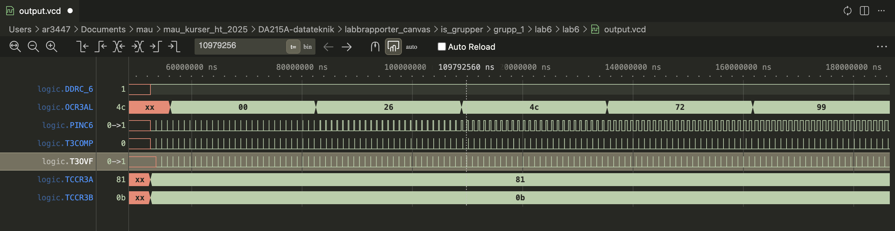

# avr-tools

This repo contains code and makefiles to be able to build, debug and simulate code for AVR MCUs, 
both for assembly and C code.

This repo contains code and makefiles intended to simplify building and debugging
C and assembler code for AVR targets – as an alternative to Microchip Studio.
At the time of writing, the C code is compiled with avr-gcc, and the assembler code is assembled with avra on 
macOS and Linux, and avrasm2 on Windows, but it is possible to use avr-gcc for assembler as well (however, note that 
the assembly language avr-gcc uses differs somewhat from standard AVR assembler, see example code). 


## Getting started
Read [the getting started guide](getting_started.md) to get up and running quickly. The bottom
line is that some tools are needed, and they need to be in the PATH environment variable for
the makefiles (the build system) to work. 


## Example code
A few example code projects can be found in the `examples` directory. These are documented 
[here](examples/README.md)

## Two project types

Two types of projects are supported, pure AVR assembler code and mixed C/assembler. In the latter, 
`avr-gcc` is used; `avr-gcc` can be used for assembler projects as well, but the assembly language differs 
somewhat from the pure AVR assembler. For pure AVR assembly language, either `avra` or `avrasm2.exe` 
is used as assembler.

[Check out the makefiles for more info](makefiles/README.md).


## Adding your own code
There are some hackish assumptions made here, to keep things simple. Some features (e.g. the VSCode
sourcing the setup script) rely on the source code being two directories down from here, i.e. like 
in the examples directory.

So, unless you want to improve the build system, make a directory with one subdirectory per project,
for instance:
```
./examples/ [...]

./my_avr_code/
             ce_lab1/
                 .vscode/
                 Makefile
                 main.c
             ce_lab2/
```

## Toolchain

### macOS

#### Prerequisites

1. Install Xcode from App Store.
2. Install xcode command line tools by running this in the terminal: <br>
`xcode-select --install`
3. Homebrew is needed to install the tools -- if you don't have Homebrew, you can install it by 
downloading an installer from https://github.com/Homebrew/brew/releases/latest; at the time of 
writing it is called Homebrew-5.0.3.pkg. After download, double-click and do the installation.

#### Installing the tools

1. Install avr-gcc by running these commands in the terminal <br>
`brew tap osx-cross/avr` <br>
`brew install avr-gcc`
2. To install the debugger, run this command: <br>
`brew install avr-gdb`
3. To install the simulator, run this command: <br>
`brew install simavr`
4. If you want to flash to an Arduino board, install avrdude like this: <br>
`brew install avrdude`

**NOTE:** The official version of `simavr` is pretty old; I have been using the latest one, installed 
like this: `brew install --HEAD simavr`.

**NOTE:** For macOS (and Linux?), `avra` is used to compile AVR assembler. On macOS, the latest 
official version does not support ATmega32U4, so this repo contains a custom built universal binary.
One big difference between `avra` and the AVR assembler used in Microchip Studio is that `avra` doesn't
accept C/C++ style comments, use `;` instead (that works in both environments).


### Windows

On Windows, life is slightly more complicated, but the same problem needs to be solved – getting
the tools and putting them in the PATH variable. A Windows native environment (such as cmd.exe 
or PowerShell) does things differently, and currently doesn't work with the makefiles – a "Unix-like" 
environment is needed. On Windows, two such alternatives I have tried are Git Bash and [WSL]
(https://learn.microsoft.com/en-us/windows/wsl/). 

Bottom line:
- Git Bash is easier to get started with, it appears to have a better relationship with Windows
  (easier to access existing Windows tools), _but_ the `simavr` simulator does not seem to exist
  natively on Windows – so no debugging using simavr.
- WSL is a bit more of a hassle to get into, but when in WSL, it's just Linux, all is good – except
  uploading .hex files to the Arduino board, because accessing USB is not plug-and-play. 
  It _is_, of course, possible to bring files in/out of WSL, so you could do the upload outside, 
  but not as streamlined.
- One option is to just use Microchip Studio – it even has a simulator.

The makefile os.mak tries to guess where the AVR assembler device include files are. If it 
fails, find where they are, and either update os.mak or define it on command line, like this: 
```
AVR_DEVICE_INC=/c/7.0/packs/atmel/ATmega_DFP/1.7.374/avrasm/inc make
```

#### Git Bash
Git Bash seems to be easier to "cross over" to native Windows, so then you can use 
Microchip Studio's AVR assembler and C compiler, as well as its `shellutils` directory
for tools like `make` etc., and Arduino's installation of `avrdude`. 

If Microchip Studio is installed, and there is a setup script (in `tools/`) that can 
be _sourced_ to set those paths in Git Bash:
```
. tools/build_setup.sh
```
Note the leading period, followed by a whitespace – that means that the script is executed 
in the terminal's process, and the PATH updates are available. 

If these paths are not correct on your computer, either update the setup script to your 
paths, or update your environment PATH variable to include them.

- The `shellutils` path is needed for `make`. 
- The `avrassembler` path is needed for the AVR assembler (`avrasm2`). 
- The `avr8-gnu-toolchain` path is needed for the `avr-gcc` tools. 


#### WSL

WSL is Linux, more or less, so it is easy to install the needed packages. 

My initial attempts were in Git Bash, using Microchip tools. That works very well 
for building and uploading, but the simulation tool that is needed for debugging 
(`simavr`) is not readily available on Windows. In WSL much or all of this can be
installed using `apt`, but uploading is probably hard to do from WSL, since you
need access to the COM port. 

I installed most tools using `apt`. The `avra` assembler is available for Linux as
well, but (like on macOS) its latest release does not does not support the ATmega32U4
MCU used in Arduino Leonardo. Instead, I have used the assembler in the Microchip
Studio toolchain, with some pretty ugly workarounds in `os.mak`.

Installing tools in WSL:
```
sudo apt-get update 

# For make and other build tools
sudo apt install build-essential

# For avr-gcc
sudo apt-get install gcc-avr

# For simavr, used for debugging
sudo apt-get install simavr
```

##### `simsim`

I used `gcc` to build the crude AVR simulator `simsim`, and `pkg-config` to get compile and link flags.
It also needs the following libs:

```
sudo apt-get install libsimavr-dev
sudo apt-get install libelf-dev
```


## Building the AVR code
The simplest way to build is to go to the main code directory (using `cd` in the terminal) and then enter 
`make` in the terminal, like this:
```
cd examples/blinky_c
make
```
This will build an ELF file (to be used for debugging) and a HEX file (which can be transferred to an Arduino 
board or used in SimulIDE).

By default, this makefile builds for ATmega32U4 (as in Arduino Leonardo); if you want to build for another 
MCU, do like this:
```
MCU=atmega328p make
```

**NOTE:** At the time of writing, for AVR assembler projects, the only supported MCUs are ATmega32, 
ATmega32U4, and ATmega328P. If the CPU of your choice causes the AVR assembler build to fail, add
it in `makefiles/avra.mak`, like this:
```
else ifeq ($(MCU),atmega328p)
DEVICE_INCLUDE_NAME = m328pdef.inc
```

### Build and upload to Arduino
If you want to upload the built firmware to the Arduino, use the make target `upload`. There is an automatic 
scan for the board, but **note:** this is currently only for macOS, and only with one (1) board connected. 
If the automatic scan fails, you can add the port by setting the variable `ARDUINO_DEVICE`on the command 
line, like this:
```
ARDUINO_DEVICE=/dev/ttyACM0 make upload
```

### Build and debug
To debug on the Arduino Leonardo boards, you will need other tools, but if building with avr-gcc you can
debug on the host computer. You will need to install simavr to use as a simulated AVR MCU, and
`avr-gdb` for debugging (using homebrew on macOS). The makefiles have a target for debugging:
```
make debug
```
This starts a simulated AVR environment, and drops you into `main` in gdb. Learn about gdb commands online, 
here is a brief intro:
- 'l': list the source code around the current line
- 'n': step over next line
- 's': step _into_ next line (i.e. into a function call)
- 'b': set a breakpoint, like this: `b lcd_init`
- 'bt': show a "backtrace", the current call stack (the function "call chain")
- 'c': continue execution (**note:** not sure how to pause; Ctrl-C disconnects the simulator, so make sure to have a breakpoint set)
- 'p <x>': print variable x – also possible to print registers, by prefixing register name with a dollar sign, like `p $r16` <br>
- 'set <x> = <y>': set variable x to y, for instance `set $r16 = 0xA8`
- 'display <x>': show variable x continuously
- 'help': displays help; you can also get help on a specific subject (like `help data`)
- 'exit': exit gdb (Ctrl-D also works, as does 'q')

Pressing the return key repeats the last command.

## Build and debug using Visual Studio Code
To run in VSCode, the code directory must contain a subdirectory called `.vscode` containing settings 
for VSCode. The example code directories contain such setup that uses the makefiles to build. For code 
built using avr-gcc, it is also possible to debug in VSCode, with a graphical interface.

### Open project
To open a code directory as a VSCode project, simply choose File->Open Folder. The directory must contain a 
.vscode subdirectory to work properly in VSCode.

### To build
Use menu selection Terminal->Run Build Task

### To debug
Set a breakpoint by opening a source file and click on a line of code _in_the_left_margin_, to the left of 
the line number. It should result in a red dot.

Start the simavr simulator by choosing menu option Terminal->Run Task, and then choose "Start simavr". 
This starts the simulator in a terminal window at the bottom. 
**NOTE:** The simulator must be explicitly terminated by pressing Ctrl-C in that terminal window.

Start the debugger by clicking the play button in the left toolbar. This opens a debug control panel to the 
left; click the play button at the top ("AVR Debug").

That should result in the code being executed and then stopped at the breakpoint (if it is reached). There 
are controls in the top of the code window to step into/over/out as well as pause/continue.

In the debug control panel to the left you can look at registers and variables. You can also enter `gcc` 
commands in the terminal at the bottom, prefixed with `-exec`.

Debugging like this works for both assembly and C code, but only if built by avr-gcc.


## Running in a simulated MCU

There are a few options to run AVR code in a simulated environment, on your computer.

Here is an overview, there is [much more on this subject here](simsim/README.md).

### simavr
The tool simavr, which is used for executing the firmware code when debugging, can also be used to
run the code freely, without a debugger attached. The problem is that by default, it just runs the
code, with no visible output. It is possible to add traces on port pins, IRQs, et cetera,
with the `--add-trace` option, and then get this saved as a `.vcd` file to be viewed in an 
external waveform viewer.

This command sets a trace on PORTC, pin 7. The simulation is stopped with `Ctrl-C` in the terminal, and then the output VCD file
is created.

```
simavr -v -m atmega32u4 -f 16000000 \
       --add-trace C7=portpin@0x7/0x43 \
       -o output.vcd build_output/blinky_asm.hex
Adding portpin trace on address 0x0007, mask 0x43 ('C7')
```

One can observe other registers as well, not just GPIO pins. 


### Simple AVR simulator

The tool `simavr` is useful in the sense that it is readily available, but not very user friendly.

I have tried to make something intended to be slightly easier to use, called `simsim` ("**sim**ple
**sim**ulator").

It is not very pretty, the best thing about it is that it displays the status of all ports in the 
terminal, live. The immediate feedback of what is happening is one of the benefits, another is 
that it is possible to pass input to it, to toggle port pins.


### Viewing VCD files
The VCD files produced by simavr can be viewed using several tools. One that often is mentioned is GTKWave.
I have used an extension to VS Code called [Vaporview](https://github.com/Lramseyer/vaporview). It looks 
like the screen of an oscilloscope or a logic analyzer.




### Running in SimulIDE
For a richer simulation environment, you can use [SimulIDE](https://simulide.com/p/). This is a standalone 
applicaton for all major operating systems that can simulate not only many AVR MCUs and some Arduino boards, 
but also things like digital circuits, passive and active analog components, power sources, measurement tools, 
and even peripherals like LCD displays.

Unfortunately, ATmega32U4 is not available there (yet). What you can do instead is to build for ATmega32, but
note that not all ports are the same as on ATmega32U4. What you can do for those ports is to define a symbolic
name for the port/pin, that you use in the code, and define them differently depending on MCU.

In pure AVR assembly language:
```
#ifdef _M32DEF_INC_
	.equ LED_OUTPUT_PORT = PORTC
	.equ LED_OUTPUT_DDR = DDRC
	.equ LED_OUTPUT_PIN_NUM = 7
#else
	.equ LED_OUTPUT_PORT = PORTE
	.equ LED_OUTPUT_DDR = DDRE
	.equ LED_OUTPUT_PIN_NUM = 2
#endif

[...]
	SBI LED_OUTPUT_DDR, LED_OUTPUT_PIN_NUM

	SBI LED_OUTPUT_PORT, LED_OUTPUT_PIN_NUM

```

When building with avr-gcc, another macro must be used: 
```
#ifdef __AVR_ATmega32__
#define LED_OUTPUT_PORT PORTC
#define LED_OUTPUT_DDR DDRC
#define LED_OUTPUT_PIN_NUM 7
#else
#define LED_OUTPUT_PORT PORTE
#define LED_OUTPUT_DDR DDRE
#define LED_OUTPUT_PIN_NUM 2
#endif
```

To build for the ATmega32 MCU, do this:
```
MCU=atmega32 make clean all
```


## Known issues

This has mainly been used and developed on macOS. Most of it ought to work on Linux and in WSL (or
Git Bash) on Windows. 

- There are some things done in the makefiles that assume a Unix type of environment (simply because
  I lack the necessary `make` and Windows skills). It should be possible to fix, but I will not do it 
  anytime soon. I have tried a lot of it in WSL, and it works OK. If you only want to build (not debug),
  Git Bash is even simpler (assuming Microchip Studio and Arduino are installed).
- On macOS, there is a script that tries to detect the Leonardo in bootloader mode – maybe this is too 
  optimistic (and error prone) – and on Windows there is a much less tested variant, but if that fails,
  or if on Linux, the device has to be passed on command line, `ARDUINO_DEVICE=/dev/ttyACM0 make` (or
  whatever the device is, something like `COM7` on Windows). Or edit `os.mak`.
- The device detection script mentioned above only works if there is one (1) device that matches the
  crude check. This can be improved, but is not (yet).
- The device detection script mentioned above also (possibly) only works on Leonardo – other MCUs than
  ATmega32U4 may need another programmer ("wiring"?).
