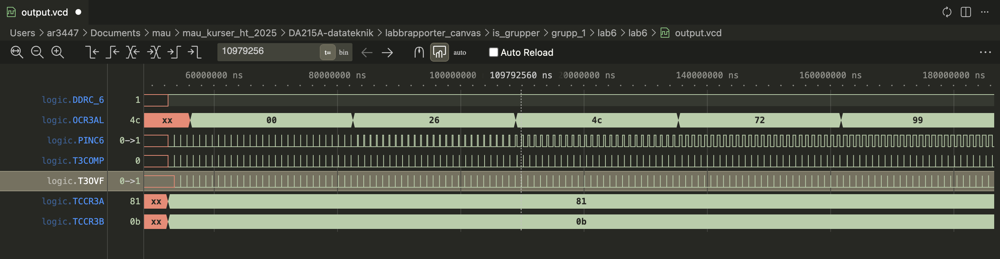
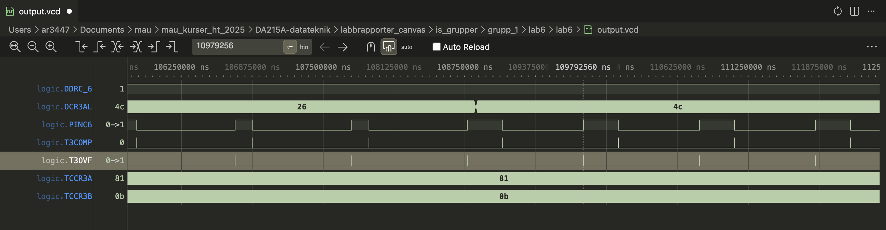

# Simulating the AVR MCU effortlessly

OK, maybe not _effortlessly_ as such, but it is pretty amazing how much you can do with
free tools with these MCUs. The UX is a bit hairy, compared to other tools, but after the
initial shock there is a lot of potential here.

This document will describe a little about how to work with both `simavr` and a custom built
variant based on `simavr`. After installation, the tool `simavr` can be used immediately on 
AVR binaries that have not been instrumented at all, the actual same binary that you can 
upload to your Arduino. So why build a tool of one's own? Well, my main reason was that I
initially wanted something with immediate feedback on what's happening (and also that I did
not understand `simavr` and its quirky UI). 

In short:
- `simavr` is an existing tool to be used out-of-the-box, with any AVR firmware, but 
it doesn't provide that much of instant feedback – it is possible to create a trace file to
be viewed afterwards
- `simavr_wrapper` is a custom built application on top of the `simavr` library; the main thing
it provides is a way to see immediately what is happening on ports (it also creates a trace file). 

Let us dig deeper.

## simavr

Run `simavr -h` to get a little help. There is a little info available on 
[its GitHub page](https://github.com/buserror/simavr), and there is also a fork that provides
[a bit more in-depth info](https://github.com/gatk555/simavr/blob/main/README.md).

I have mostly used this on macOS, and on macOS you typically install it using the package 
manager [homebrew](https://brew.sh). Or, you can download the source code and build it yourself!

The latest official release is pretty old, so I have installed the very latest, like so:
```
brew install --HEAD simavr
```

If on Windows, I would really recommend getting into [WSL](https://learn.microsoft.com/en-us/windows/wsl/),
which allows you to run Linux (sort of), and Linux is a lot nicer environment to code in. 

### Run `simavr`
This is basically how you run it from a terminal.

```
simavr -v --mcu atmega32u4 --freq 16000000 firmware_file.elf
```
You can also run `.hex` files, but I've read that `.elf` is preferred.

So, this runs the code, but you will not see it. It is possible to start it like this with
the `--gdb` flag set and then attach a debugger to it, but other than that, there's not much
happening. 

It _is_ possible to pass a `.vcd` file for input signals – I never tried that – and also save a
`.vcd` file with trace output – but a plain firmware will not generate any traces.

### The `-ti <vector>` argument
This is a quick way to get interrupt traces directly in the command line. Interrupts that happen
frequently will quickly fill the terminal, though, so maybe redirect the output to a file. 

The vector number that is needed as argument can be found in the MCU datasheet (search for 
Interrupt Vectors, or something like that). It seems to me that they are numbered "one off", 
they start at 1, and I think simavr start at 0. I usually check the header file that defines
these MCU specific things, e.g. `/opt/homebrew/Cellar/avr-gcc@9/9.5.0/avr/include/avr/iom32u4.h`.

For instance, for the ATmega32U4, to trace the ADC interrupt:
```
simavr -v --mcu atmega32u4 --freq 16000000 -ti 29 firmware_file.elf
```

See below for an interesting tale about this `simavr` argument. 

### The `--add-trace` argument

This is where you can actually do something with a plain firmware binary and a standard `simavr`
tool – this argument lets you add traces in several ways. The traces are not available "live",
you have to save them to a file, with the argument `--output trace_out.vcd`.
Such VCD files must be viewed in a waveform viewer – one that often is mentioned is GTKWave. 
Not available on macOS (anymore, I think), so I use a plugin to VS Code called Vaporview.

The basic format of the argument is this:
```
--add-trace <name>=<kind>@<addr>/<mask>
```
This is a slightly simplified view, see the help text, the source code, and [the forked readme]
(https://github.com/gatk555/simavr/blob/main/README.md) for details. 

- `<name>` is a name you provide, max 63 characters long (if I read the code correctly)
- `<kind>` is the kind of trace you want to do – this choice affects how the rest should look

So, let us look at the last pieces "per trace kind", for some types.

#### `trace`
For the `trace` kind:
- `<addr>` is a memory mapped address to a register – like `PORTB` for instance
- `<mask>` is a bit mask filtering out which bits of the register you are interested in

The addresses can be found in the datasheet (see "Register Summary") – use the ones within
parantheses, they represent "memory mapped" I/O addresses.

So, to see the action on pin 3 in PORTB – PORTB has the memory mapped address 0x25:
```
simavr -v --mcu atmega32u4 --freq 16000000 --add-trace PB03=trace@0x25/0x08 -o trace.vcd firmware_file.elf
```
(The `-o` is  short for `--output`.)

#### `portpin`
The `portpin` kind is more specific, it is exclusively to trace, well, port pins:
- `<addr>` is the pin number of interest
- `<mask>` is a reference to the port register you are interested in

The port reference is represented in a pretty weird way – it is the capital letter naming the port, 
like e.g. 'B', which is user friendly – not passed as is, though, but instead as its ASCII code, in hex.

So, to see the action on pin 3 in PORTB – 'B' has the ASCII code 0x42:
```
simavr -v --mcu atmega32u4 --freq 16000000 --add-trace PB03=portpin@0x03/0x42 -o trace.vcd firmware_file.elf
```

#### `irq`
The `irq` kind is to trace interrupts:
- `<addr>` is the "interrupt event index"
- `<mask>` is the interrupt vector of interest

The interrupt event index is – I _think_ – either:
- 0, for when the interrupt occurs, or
- 1, for when the interrupt handler is executed

So, to see when the interrupt handler for the ADC complete interrupt is executed – the ADC interrupt
has the vector number 29, which is 0x1D:
```
simavr -v --mcu atmega32u4 --freq 16000000 --add-trace ADCISR=irq@0x01/0x1D -o trace.vcd firmware_file.elf
```

### Instrumenting the code
It is also possible to add stuff in the firmware code, like for instance adding traces, in
a way that `simavr` understands.

Here is an example: 
```
#ifdef _SIMAVR_BUILD_
#include "avr/avr_mcu_section.h"

AVR_MCU_STRING(AVR_MMCU_TAG_NAME, "atmega32u4");
AVR_MCU_VOLTAGES(4700, 4700, 1100);

const struct avr_mmcu_vcd_trace_t _trace[] _MMCU_ = {
    { AVR_MCU_VCD_SYMBOL("DDRC_6"), .mask = (1 << 6), .what = (void*)&DDRC },
};
#endif
```

- The `_SIMAVR_BUILD_` define comes from the avr-gcc makefile in this repo, it is defined
when building with `make simavr`. In addition to adding that define, it also adds the 
necessary compiler and linker flags to `simavr`.
- The included header file contains all things needed for this (I think).
- The next line defines the MCU type – I think `simavr` then can do without the `--mcu`
flag (there is also a way to set frequency).
- The macro `AVR_MCU_VOLTAGES` sets some voltages needed for the ADC to "work". 
- And the array of trace structs at the end is for programmatically adding VCD traces 
in the firmware code – just add more lines if you want more traces.

The code snippet above was added to a firmware that used a timer to create a PWM output. The pulse width duty cycle was set to increase every 10 ms or so. 

This simavr command added more traces, in addition to the one added programmatically.

```
simavr -v -m atmega32u4 -f 16000000       \
       --add-trace PINC6=trace@0x26/0x40  \
       --add-trace TCCR3A=trace@0x90/0xFF \
       --add-trace TCCR3B=trace@0x91/0xFF \
       --add-trace OCR3AL=trace@0x98/0xFF \
       --add-trace T3COMP=irq@0x00/0x20   \
       --add-trace T3OVF=irq@0x00/0x23    \
       -o output.vcd build_output/lab6.elf
```
PINC6 is – for some reason – where `simavr` displays the output (the output was set to pin 6 in port C, as an alternate function for that pin).

This is how a trace from this setup looked in Vaporviewer in VS Code, first a little bit zoomed out. It is clearly visible that pin 6 in DDRC is set in the code's initialization, as is the timer control registers – and to _what_. Good debugging information.


And then, by zooming in, it is possible to see a more detailed view – for instance, it is clearly visible that the timer's overflow event sets the output high, and the "compare match" event resets it. 


### An interesting sidetrack regarding the dangers of C
One annoying thing with open source software is that it often is poorly documented. 
On the flip side, you have access to the source code! (And also, many commercial products
are poorly documented as well.)

When looking in the `simavr` source code to try to understand how to use it, particularly 
what kind of traces the `-ti` argument created, I noticed this bug:

```
int main(int argc, char *argv[]) {
[...]
	int trace_vectors[8] = {0};
	int trace_vectors_count = 0;
[...]
		} else if (!strcmp(argv[pi], "-ti")) {
			trace_vectors[trace_vectors_count++] = atoi(argv[++pi]);
		} else if [...]
```

**NOTE:** This has _nothing_ to do with simulating AVR MCUs, but it has everything to do with
programming in C.

The option `-ti` takes one argument, the integer interrupt vector number to trace, and it can be
passed several times, to add more than one interrupt trace. To be able to keep track of more than
one such trace, there is an array of integers defined on the stack. Its capacity is set to eight
elements, and there is a counter to increment for new IRQ traces, but there is no check if the 
counter goes outside the array bounds. 

After adding eight `-ti` arguments, the ninth such argument will – since this is C – be stored 
as if there was no size limit in the array, thus overwriting whatever comes after it on the stack.

This is what is known as "stack buffer overflow" – it is bad and can cause real harm. There is 
a very interesting paper written on this subject called [Smashing The Stack For Fun And Profit]
(https://inst.eecs.berkeley.edu/~cs161/fa08/papers/stack_smashing.pdf) – it is a good read not
only because it it gives an insight in how C works (you can get a real sense of how dangerous C
can be, and why you have to be careful), but it is also fun. 

I have tried passing more than eight `-ti` arguments, and yes, it behaves oddly. If you read the 
paper, you already know that exactly _how_ it behaves, in what particular odd way, depends on 
what arguments you pass. 

The error log made me suspect that the overwritten variable contained the MCU name, and yes, by
passing eight `-ti` arguments, I let the ninth be 72, which is a readable ASCII code:

```
simavr -m atmega32u4 -f 16000000 -ti 29 -ti 2 -ti 3 -ti 4 -ti 5 -ti 6 -ti 7 -ti 8 -ti 72 lab6.elf            
avr_make_mcu_by_name: AVR 'H' not known
simavr: AVR 'H' not known
```


## simavr_wrapper

This is a custom built simulator, built on the library that is shipped with `simavr`.
You will have to build it yourself – at the moment `clang` and `pkg-config` are needed for
this.

If you are standing in this directory, just execute the command `make`.

So, how does it work? At the time of writing, it only takes an `.elf` or `.hex` file as
argument. So yes, the MCU and frequency are hardcoded, to ATmega32U4 and 16000000 respectively.

When started, it displays what is happening on all ports – the most significant bit to the left.

It is possible to pass input. Not in a very clear way, but still (it is a hack!). The input is 
done by typing a command character in the terminal and pressing enter. The command characters 
will get erased from the screen (because of a lazy programmer), but they will still count.
The code's intention is to read one character at the time, and it does, but it also works 
(or seems to work) as well to type more than one character before pressing enter.

These are the commands:
- 'q': to exit
- 's': to toggle the speed – entering it once makes the simulator go slower, once more: it's back to "normal speed"
- 'b0': for GPIO input, type the port letter followed by the pin to toggle

In the last case, 'b0' is only an example. Also, as mentioned above, it is possible to type both 
the sequence "'b', enter, '0', enter" as well as "'b', '0', enter". 

Not a very nice UI, but it kinda works. It would probably work OK to instead communicate 
with a real GUI over a socket.

In addition to this, it also creates a VCD trace file containing _all_ ports by default.
Again, this is caused by laziness. There have been thoughts about some command line interface for it,
but not yet.
